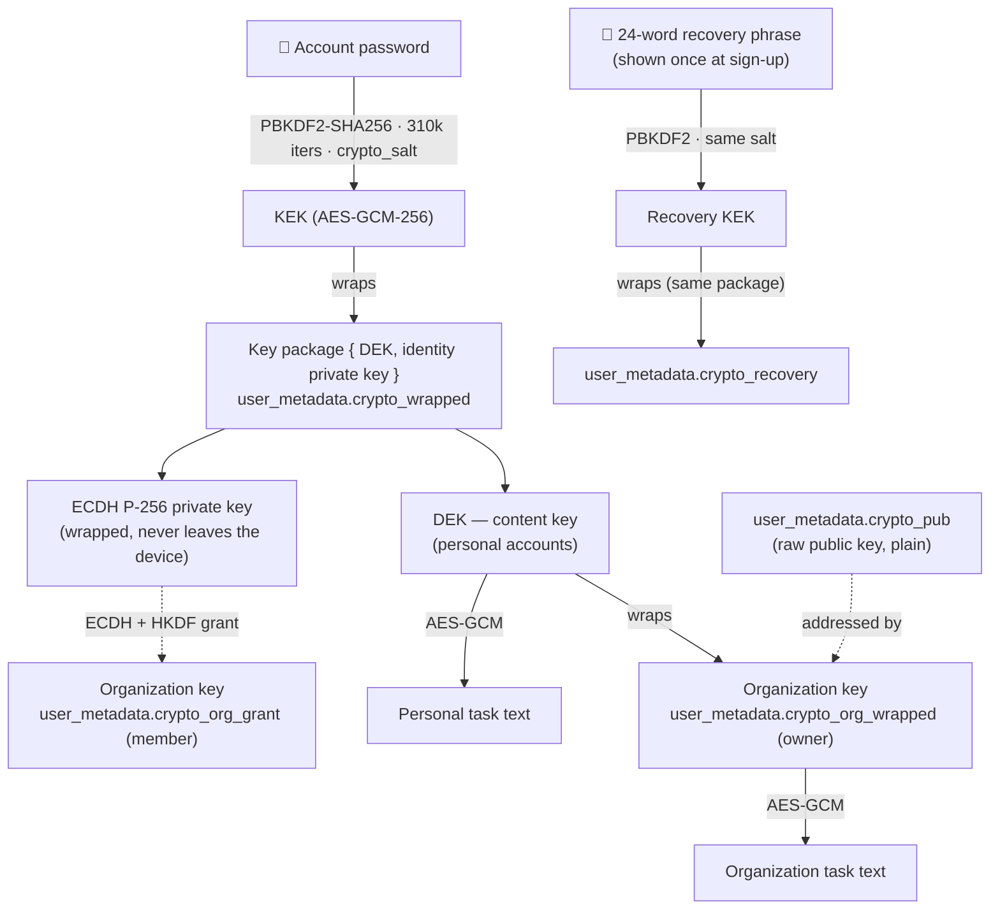
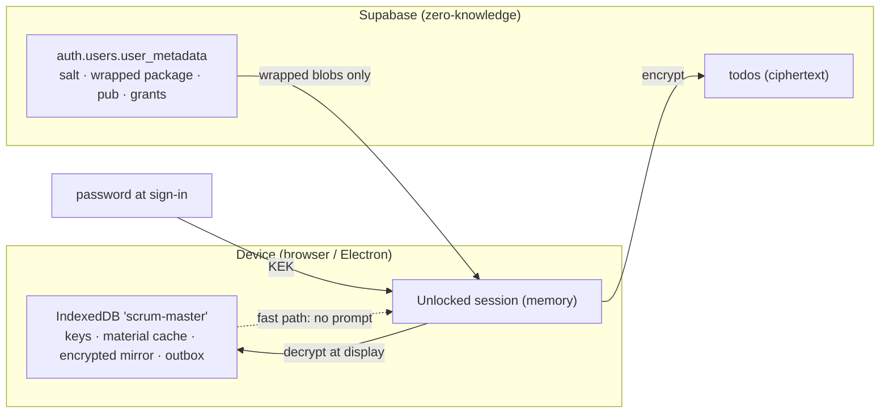
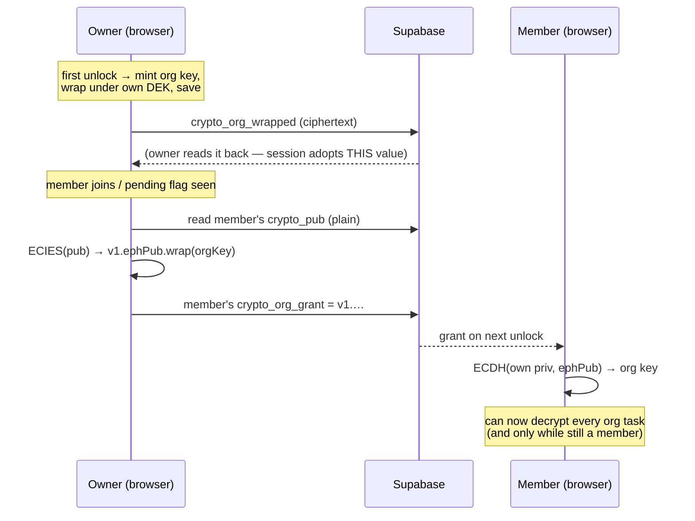
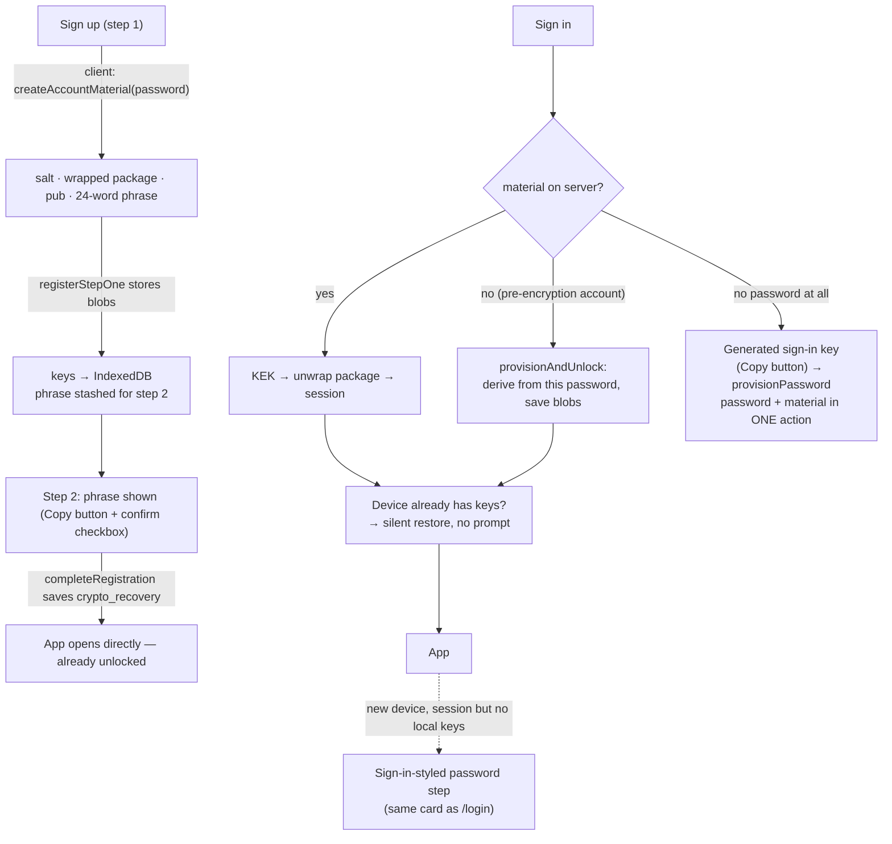
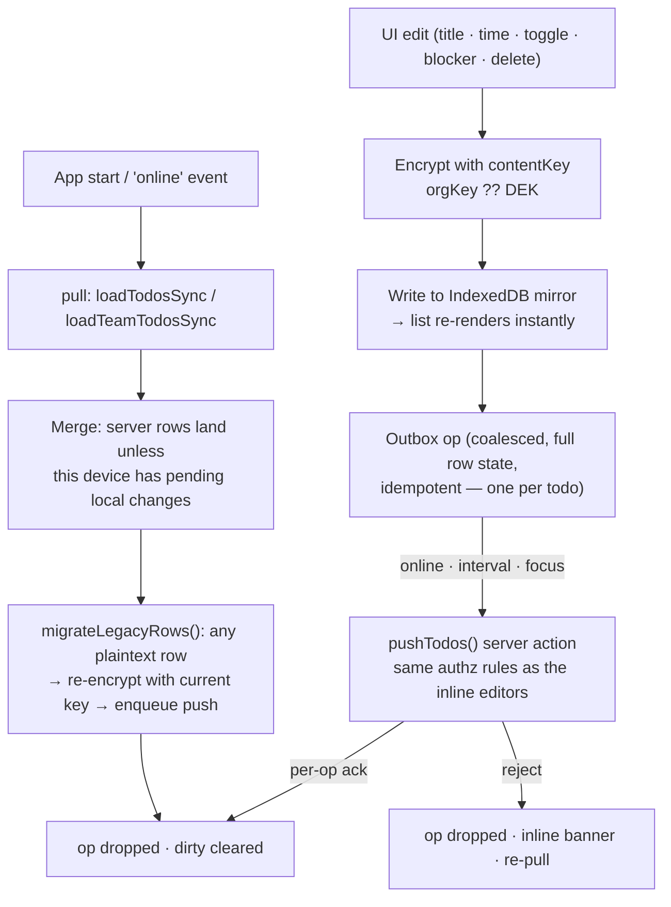
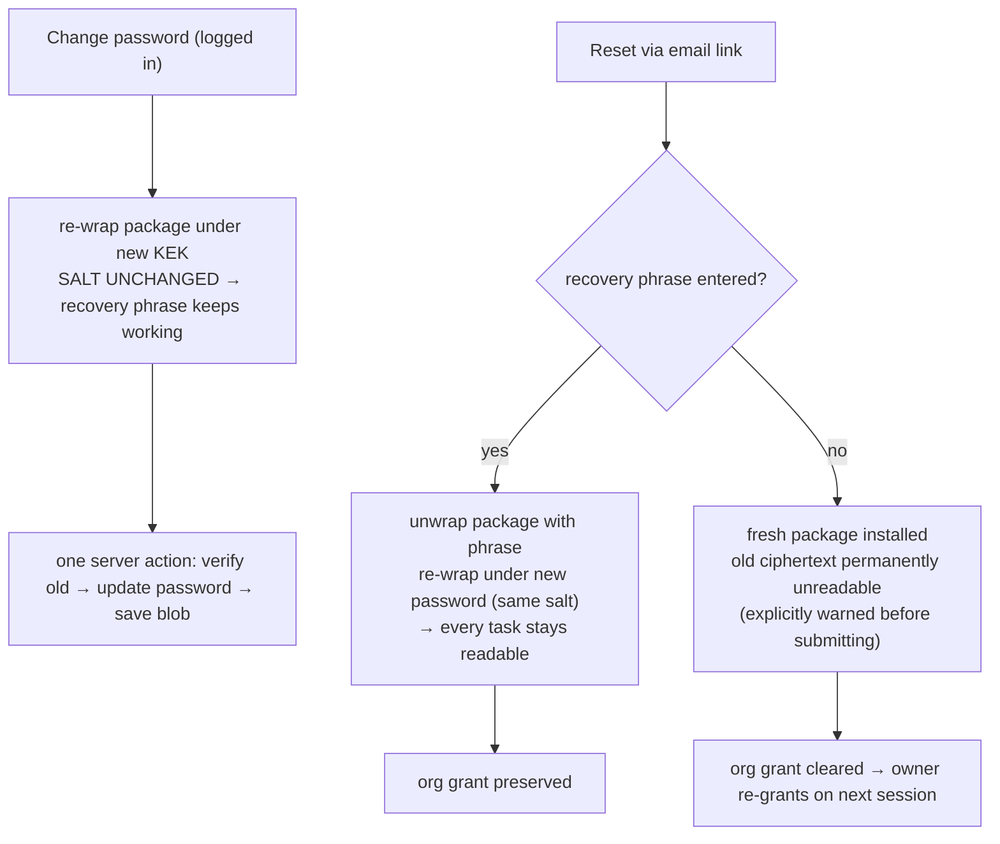

# Scrum Master — End-to-End Encryption & Offline-First Architecture

Task content is encrypted in the browser **before it reaches Supabase**. The
server stores only ciphertext and metadata it legitimately needs (times,
status, assignees, counts) — it can never read a task title or blocker. The
same encrypted dataset is mirrored locally in IndexedDB, so the app is
instant and fully usable with no network.

---

## 1. Key hierarchy



| Piece | Algorithm | Stored where | Server can read it? |
|---|---|---|---|
| KEK | PBKDF2-SHA256, 310 000 iters, 16-byte salt | derived, never stored | ❌ needs the password |
| Key package `{dek, priv}` | AES-GCM under KEK | `user_metadata.crypto_wrapped` | ❌ ciphertext |
| Recovery copy of the package | AES-GCM under PBKDF2(mnemonic, salt) | `user_metadata.crypto_recovery` | ❌ ciphertext |
| Salt | random 16 bytes | `user_metadata.crypto_salt` | ✓ (harmless) |
| Identity public key | ECDH P-256, raw | `user_metadata.crypto_pub` | ✓ (by design) |
| Organization key (owner) | AES-GCM under DEK | `user_metadata.crypto_org_wrapped` | ❌ ciphertext |
| Organization key grant (member) | ECIES: ephemeral ECDH → HKDF-SHA256 → AES-GCM | member's `crypto_org_grant` = `v1.<ephPub>.<iv‖ct>` | ❌ ciphertext |
| Task title / blocker | AES-GCM under DEK **or** org key | `todos.title`, `todos.blocker` | ❌ ciphertext |

**Task field envelope** (what a row actually stores):

```
enc:v1:Zm9vYmFy…            ←  "enc:v1:" + base64( 12-byte IV ‖ AES-GCM(ciphertext ‖ 16-byte tag) )
```

Values **without** the `enc:v1:` prefix are legacy plaintext from builds
before encryption — they keep rendering as-is and are transparently
re-encrypted on the next sync (see §5, migration pass).

---

## 2. Who holds which key



- **Unlocked keys live in memory + IndexedDB** (this device only) so return
  visits open silently; sign-out drains the outbox, then wipes both.
- The server holds only wrapped blobs — losing the server leaks nothing
  readable; losing **both** password and recovery phrase loses the content
  (the tradeoff below).

---

## 3. The org key: admin access without breaking zero-knowledge

The requirement: *the organization owner must still open every member's
tasks as usual.* One random organization key provides that — and it is
distributed without the server ever seeing it:



**Safety invariants** (these exist because a re-mint once orphaned tasks):

1. The owner path **re-reads the server** before ever minting — a stale
   local cache can never trigger a replacement key.
2. `saveCryptoMaterial` **refuses to overwrite** an existing
   `crypto_org_wrapped` with a different value (covers racing unlocks).
3. After saving, the session **adopts whatever the server kept** — every
   unlock converges on the one stored key.
4. If a stored wrap exists but will not open, the gate reports the error
   instead of minting (never silently break existing ciphertext).

Removing a member revokes future access at the data-serving layer (rows stop
being sent); the member's cached copy is purged on their next sync pull.

---

## 4. Sign-in / sign-up: key lifecycle



- Everything key-related happens **inside the sign-in/sign-up form submit** —
  there is no extra “unlock” round for normal logins.
- **Legacy accounts** sign in with their existing password; keys are derived
  from it automatically and their plaintext todos keep working (§5).

---

## 5. Offline-first sync loop



| Property | Behaviour |
|---|---|
| Writes while offline | Applied locally, queued, flushed on reconnect — never lost |
| Conflicts | Last successful push wins; a device with pending ops keeps its own copy until pushed |
| Idempotency | Ops carry full row state and coalesce per todo → safe to retry |
| Search / tab filters | Client-side over decrypted text (the server *cannot* search ciphertext) |
| Sign-out | Best-effort drain → wipe mirror, outbox, keys → session ends |

## 6. Where decryption happens (display boundary only)

| Surface | Behaviour |
|---|---|
| Home & team lists (`TaskBoard`) | Mirror rows decrypted on load; server passes ciphertext |
| Row editing (`TaskRow`, composer, toggle) | Encrypts before local write; server never sees plaintext |
| Reports | `ReportClient` decrypts rows; **PDF is generated in the browser with jsPDF** (the server can't read titles) |
| Bell popup / notifications page / OS alerts | `decorateNotification()` decrypts title and composes `Blocked — …` client-side |
| Digest email & web push | **Counts only** ("3 overdue") — crosses the server, which cannot read titles |
| Sidebar counts, nudge logic, scheduling | Plaintext *metadata* only (completed, times, created_at) — unchanged |

## 7. Password & recovery flows



- The **24-word phrase** shown at sign-up (with a **Copy** button and a
  required “I saved it” checkbox) is the only recovery path for a lost
  password — that is the deliberate tradeoff of zero-knowledge.

## 8. Accepted tradeoffs (by design)

- ❌ **No server-side text search** — filtering runs on decrypted data in
  the client (the dataset per user is small by design).
- ❌ **No task titles in server-generated email/push** — digests carry counts
  and a link; titles appear only in client-decrypted surfaces.
- ⚠️ **Lost password + lost phrase = lost content** — the server holds only
  ciphertext by construction.
- ✅ **Admin/org access preserved** — the org key (owner mint, member
  grants) keeps organization-wide views, assignments and reports working.
- ✅ **Offline** — full read/write with no network; background sync when
  back.

---

*Implementation: `src/lib/crypto.ts` (primitives), `src/lib/keys.ts`
(lifecycle + org handshake), `src/lib/localdb.ts` (mirror/outbox),
`src/lib/sync.ts` (encrypt → local → push, migration), `src/app/actions/crypto.ts`
+ `src/app/actions/sync.ts` (server side, ciphertext only),
`src/components/CryptoGate.tsx` (unlock states).*
